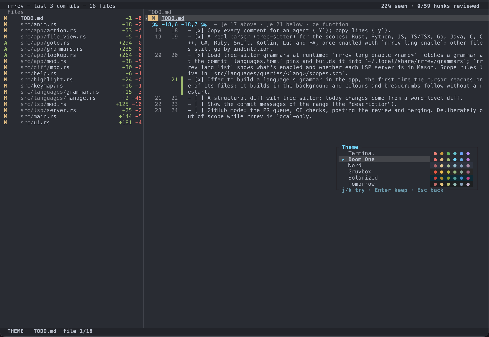

# rrrev

With the current state of development we spend almost all of our time reviewing code (or at least I do!), yet the usual review tools either suck or don't really allow us to fully explore the code surrounding a diff. Behold, rrrev: a fully keyboard-driven (VIM style keybindings) review tool that runs on your terminal, right by your agent's side.

<p align="center">
  
</p>

## Features!

- Review any set of changes, from uncommitted work to staged changes, the last N commits, a single commit, commit..ranges, everything since a commit, or a branch against the branch it split off. Oh, and did I mention you can also review each layer of a stack at a time quickly?
- Treesitter highlighting, word-level tints for what changed, `-` to hide deletions (to focus on the current state of the file) and auto line wrapping when your terminal panel is not wide enough.
- Get context beyond the hunk via the built-in LSP (if you need to navigate to the definition, get references, etc.) or simply expand the whole function with `ze`. `[e` and `]e` to read 20 more lines or press `Return` to get the full file.
- I heard you like AI, so I put AI on your AI code: use `:organize` to get your agent (Claude only for now, potentially configurable in the future) to build a review plan with notes shown inline or press `a` to ask about the line, selection or hunk under the cursor.
- No wall of changed imports: hunks that only touch imports, exports and the like (found with each language's tree-sitter grammar) start folded and marked as plumbing, and files that are nothing but plumbing, lockfiles included, fold whole with a Plumbing badge. They count as done, so `]u` skips them. `za` on the header opens one.
- Track your progress with a built-in way of marking files and hunks as reviewed with `r`, or get a end verdict and summary of how far you've made it with `S`.
- Comment on a line or two or three and manage them from `:comments`. Once you're done with your review tell your clanker to go over it using `Y` to copy a ready prompt or `--export` to md or json.
- And of course some nice themes you can switch with `T`, so nice that they follow your OS' theme.

## Limitations!

I've made this for me and myself only, which means I implemented only those features I actually do use, so right off the bat:
- No side-by-side view. I always found it confusing, I prefer to just press `-` and see the latest state of the file and only use surface those when I do want to see them.
- No configurable keybindings. Sorry not sorry.
- No PR mode, local only. Maybe in the future, who knows.
- LSPs need Neovim's Mason, so unless you already have a Neovim installation using Mason you might have a hard time setting languages up. Just get your agent to help you.

## Building

You need Rust 1.85 or newer, so the usual [rustup](https://rustup.rs) way or, you know, just get your agent to do it. Once that's done:

```sh
cargo build --release
# or install it onto your PATH:
cargo install --path .
```

The binary ends up at `target/release/rrrev`. Run `cargo test` to run the tests.

### Extras

- **Syntax highlighting and breadcrumbs:** `rrrev lang enable <name>` fetches a grammar and builds it into `~/.local/share/rrrev/grammars`, which needs `git` and a C compiler (`cc`, or `c++` for grammars with C++ scanners). `rrrev lang list` shows supported languages.
- **Language servers (`gd`, `gr`, `K`):** rrrev looks for servers in Neovim's Mason folder (`~/.local/share/nvim/mason/bin`).
- **AI features (`:organize`, `a`):** these need the `claude` CLI on your `PATH`. Set `RRREV_CLAUDE` to point at a different binary.
- **Stack review:** `rrrev stack` needs `gh stack`.

## AI usage on this repo

The tool was pretty much completely vibe coded. I do plan on eventually revisiting the code to do a refactor of some parts to enable reusing the core on other frontends, but yeah, funnily enough this tool about reviewing code has code that has not been reviewed. I don't have time for it, I wanted to enable good reviews on some other actually important projects I'm working on. If that's important to you then go ahead and fork and do whatever you want with it :^)

P.S: I actually did write this README by hand in case you didn't notice. No AI can sound this nice and make this many mistakes.
